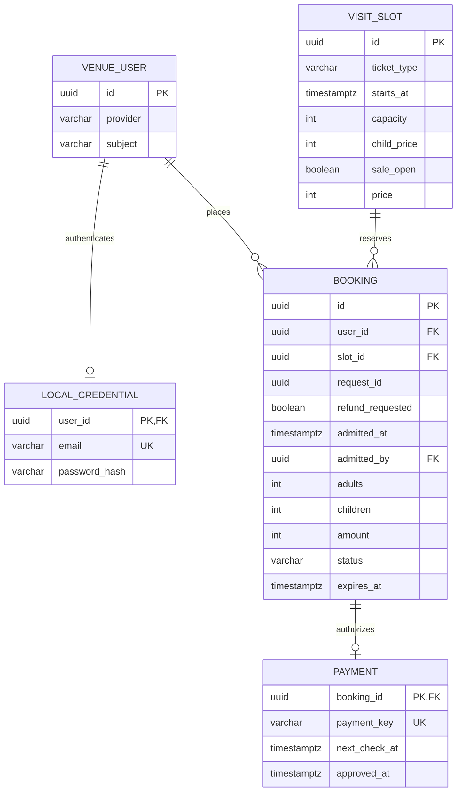

# 설매 개발 ERD

[테이블 생성 SQL](../backend/src/main/resources/schema.sql) · [프로젝트 실행 방법](../README.md)

| 테이블 | 관계 및 제약 |
| --- | --- |
| VENUE_USER | 기본 회원은 내부 UUID, 소셜 회원은 제공자의 고유 ID를 subject에 저장. provider와 subject 조합은 고유 |
| LOCAL_CREDENTIAL | 기본 로그인 회원의 이메일과 비밀번호 해시. 이메일 고유 제약 |
| VISIT_SLOT | 이용권 종류와 시작 시각 조합은 고유. 정원과 원화 단가는 양수 |
| BOOKING | 회원과 회차를 참조. 회원별 request_id가 같은 요청의 중복 예약을 방지. 예약 시점의 합계 금액을 보관 |
| PAYMENT | 예약당 승인 시도 한 건. 결제 키 중복 방지. 승인 시각은 결제사 확인 전까지 비어 있음 |

**좌석과 확정** — 예약 시 DB에서 회차를 잠그고 잔여 좌석을 다시 계산한다. 결제 대기 좌석은 최대 10분 동안 확보한다. 유효기한이 지나면 조회 결과에 EXPIRED로 표시되고 잔여석으로 돌아간다. 결제 승인 확인 중인 PROCESSING 좌석과 확정 좌석은 계속 차감한다.

**승인 흐름** — PENDING → PROCESSING → CONFIRMED. 결제사 결과가 불명확하면 PROCESSING을 유지한다. 같은 주문의 승인 재요청에는 동일한 멱등 키를 사용하고 이미 확정된 주문은 저장된 예약을 반환한다. 사용자는 결제 전 예약을 취소할 수 있다. 회차 시작 전 미입장 확정 예약은 전액 환불을 요청할 수 있다. 환불 결과 확인 전에는 좌석을 유지한다.
